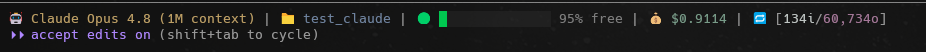

# Claude Code Status Line

A compact, colorful status line for [Claude Code](https://claude.com/claude-code) — model, git branch + dirty state, working directory, a live context-window gauge, session cost, and token transfer.



```
🤖 Claude Opus 4.8 | 🌿 [main] | 📁 my-project ✓ | 🟢 ████░░░░░░ 60% free | 💰 $0.91 | 🔁 [134i/60,734o]
```

## What it shows

| Segment | Meaning |
|---|---|
| 🤖 **Claude \<model\>** | Current model display name |
| 🌿 **[branch]** | Git branch — green when clean, red when dirty (hidden outside a repo) |
| 📁 **dir ✓ / ✗** | Working directory basename; `✓` git clean, `✗` uncommitted changes |
| 🟢 **bar + % free** | Context-window gauge — how much room is left before auto-compact. Fill goes green→yellow→red; icon escalates 🟢→⚡→🔥→🚨. Understands the 1M-token window. |
| 💰 **$cost** | Session cost, computed from transcript tokens |
| 🔁 **[Ni/Mo]** | Total input (`i`, cyan) / output (`o`, magenta) tokens this session |

Pure Python, no dependencies, no `jq`. Works on Windows / macOS / Linux and never crashes the footer — on any error it still prints a minimal line.

## Install

Requires Python 3.8+ on your `PATH`.

```bash
git clone https://github.com/<you>/claude-statusline.git
cd claude-statusline
python install.py
```

The installer copies `statusline.py` to `~/.claude/statusline.py` and sets `statusLine` in `~/.claude/settings.json` (backing up anything it replaces to `*.bak`). Open a new Claude Code session to see it.

### Manual install

Copy `statusline.py` anywhere, then add to `~/.claude/settings.json`:

```json
{
  "statusLine": {
    "type": "command",
    "command": "python \"C:\\Users\\you\\.claude\\statusline.py\"",
    "padding": 0
  }
}
```

## Configure cost

Edit the constants at the top of `statusline.py` to match your [pricing](https://www.anthropic.com/pricing#api):

```python
INPUT_COST_PER_MILLION  = Decimal(3)
OUTPUT_COST_PER_MILLION = Decimal(15)
```

> Note: cost & 🔁 tokens sum every `input_tokens`/`output_tokens` in the transcript, which includes cache reads/writes — so the figure runs higher than the raw billed input. It's a session-activity gauge, not an invoice.

## Credits

Ported to Python and extended (git icon, context gauge) from a Ruby
[gist by @justindell](https://gist.github.com/justindell/bdb5c5ecf2549d116813f0817673b5fb).

## License

MIT — see [LICENSE](LICENSE).
